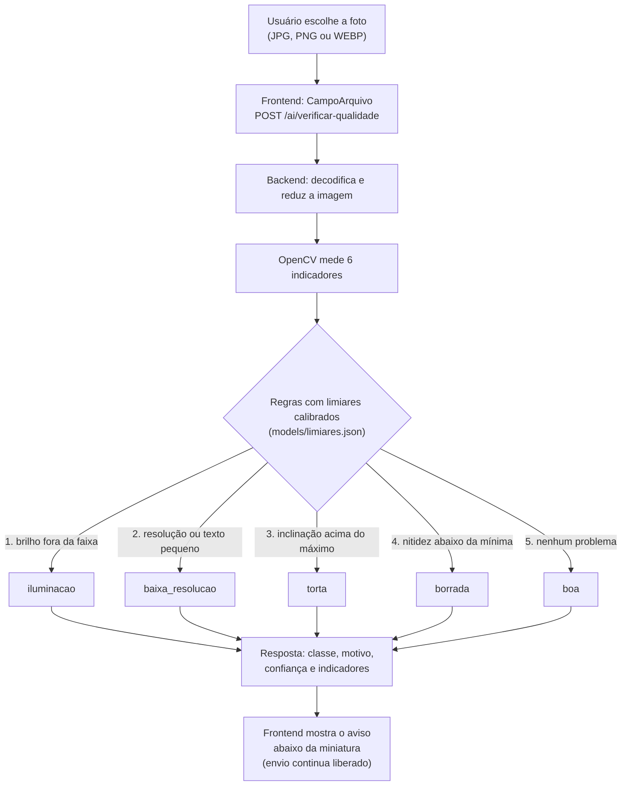

# LifeScan: verificação de legibilidade de fotos de documentos

Componente de Inteligência Artificial do LifeScan, no eixo **Computação Visual**. Este documento
descreve o que o componente faz, como funciona, de onde vêm os dados, os resultados obtidos, as
limitações e como reproduzir tudo. Ele serve de base para a seção de IA do relatório do projeto.

## 1. Problema e objetivo

No LifeScan, o paciente e os parceiros enviam fotos de documentos: exames, laudos, planos e
orientações. Muitas dessas fotos chegam borradas, escuras, pequenas ou tortas, e o médico só percebe
o problema ao abrir o arquivo. Nesse ponto, o paciente já saiu do consultório ou do laboratório e
precisa refazer o envio.

O componente avalia a foto **no momento em que ela é escolhida, antes do envio**, e mostra um aviso
com o motivo e uma orientação de como corrigir. Por exemplo:

> A foto está fora de foco. Segure o celular firme e tente novamente.

O aviso é **orientativo**: ele não bloqueia o envio. O usuário pode enviar a foto mesmo com o aviso,
porque um falso positivo nunca deve impedir a entrega de um documento de saúde.

## 2. Classes

| Classe | Significado | Legível? | Como o aviso aparece |
|---|---|---|---|
| `boa` | Nítida, bem iluminada e com texto legível | Sim | Nenhum aviso |
| `torta` | Legível, mas o documento está inclinado | Sim | Dica, em azul (`info`) |
| `borrada` | Fora de foco | Não | Aviso, em amarelo (`alerta`) |
| `iluminacao` | Escura demais ou com brilho estourado | Não | Aviso, em amarelo |
| `baixa_resolucao` | Imagem pequena ou documento longe demais | Não | Aviso, em amarelo |

O backend define `legivel = classe in ("boa", "torta")`.

## 3. Como funciona

O componente não usa uma rede neural. Ele mede seis indicadores de qualidade da imagem com o OpenCV
e aplica regras de decisão cujos limiares foram **calibrados** num conjunto de treino. A escolha foi
deliberada: o problema é de qualidade de captura, e não de reconhecimento de conteúdo. Medidas
clássicas de visão computacional resolvem esse problema, são explicáveis (cada aviso aponta o
indicador responsável) e rodam no servidor sem GPU.



### 3.1 Indicadores

| Indicador | Como é calculado | O que detecta |
|---|---|---|
| `nitidez` | Variância do operador Laplaciano | Foto fora de foco |
| `brilho` | Média dos tons de cinza (0 a 255) | Foto escura ou estourada |
| `contraste` | Desvio-padrão dos tons de cinza | Foto "apagada" (registrado, não decide classe) |
| `resolucao_px` | Menor lado da imagem original, em pixels | Imagem pequena |
| `altura_texto_relativa` | Altura mediana das faixas de texto ÷ altura da imagem | Documento longe demais |
| `angulo` | Inclinação mediana das faixas de texto, em graus | Documento torto |

As faixas de texto são encontradas por limiarização de Otsu, fechamento morfológico horizontal e
detecção de contornos. O script de calibração e o backend usam a **mesma fórmula**, para que o que
foi calibrado seja exatamente o que roda em produção.

### 3.2 Ordem das regras

1. Brilho fora da faixa → `iluminacao`.
2. Resolução baixa ou texto pequeno → `baixa_resolucao`.
3. Inclinação acima do máximo → `torta`.
4. Nitidez abaixo da mínima → `borrada`.
5. Nenhuma das anteriores → `boa`.

A ordem importa. A iluminação vem primeiro porque uma foto estourada também perde nitidez, e seria
classificada como borrada pelo motivo errado. A resolução vem antes da nitidez porque uma imagem
pequena não tem bordas suficientes para medir o foco.

A **confiança** (0 a 1) vem da distância entre o indicador decisivo e o seu limiar: quanto mais
longe do limite, maior a confiança.

### 3.3 Calibração

Os seis limiares (`nitidez_minima`, `brilho_minimo`, `brilho_maximo`, `resolucao_minima_px`,
`altura_texto_relativa_minima` e `angulo_maximo`) são calibrados por **busca coordenada** no conjunto
de treino. O script ajusta um limiar de cada vez, com os outros fixos, testando candidatos (quantis
do indicador ou valores fixos) e mantendo o que maximiza o **F1 macro** das cinco classes. Faz isso
em algumas passadas. A busca em grade completa foi descartada porque seis limiares geram mais de 500
mil combinações.

O resultado fica em `ai-model/models/limiares.json`. O backend apenas lê esse arquivo: o modelo não
é treinado em execução, e o frontend nunca acessa o modelo.

## 4. Integração no sistema

| Camada | Onde | O que faz |
|---|---|---|
| Modelo | `ai-model/models/limiares.json` | Limiares calibrados e métricas da última calibração |
| Backend | `backend/app/services/qualidade_imagem.py` | Mede os indicadores e classifica |
| Backend | `POST /ai/verificar-qualidade` (`backend/app/routers/ia.py`) | Recebe a foto (`multipart/form-data`, campo `arquivo`), exige login, respeita o limite de upload |
| Frontend | `verificarQualidade()` em `frontend/src/api/servicos.js` | Chama a rota |
| Frontend | `CampoArquivo` em `frontend/src/components/ui.jsx` | Chama a IA quando o arquivo é imagem e mostra o aviso abaixo da miniatura |

Exemplo de resposta:

```json
{
  "legivel": false,
  "classe": "borrada",
  "motivo": "A foto está fora de foco. Segure o celular firme e tente novamente.",
  "confianca": 0.87,
  "indicadores": {
    "nitidez": 41.2, "brilho": 182.0, "contraste": 60.1,
    "resolucao_px": 1200, "altura_texto_relativa": 0.011, "angulo": 1.2
  }
}
```

Comportamento no frontend:

- **Tipo de arquivo:** só arquivos `image/*` passam pela IA. PDF, DOCX e TXT não são analisados.
- **Falha da rota:** se a rota falhar (rede, componente indisponível, formato não suportado), nada
  aparece e o envio segue normal.
- **Troca rápida de foto:** se o usuário trocar a foto antes da resposta chegar, a resposta da foto
  anterior é descartada. O resultado fica guardado junto do arquivo a que se refere.
- **Enquanto a análise roda:** o campo mostra "Verificando a qualidade da foto…".
- **Botão de envio:** fica sempre habilitado. O aviso termina com "Se preferir, você pode enviar
  assim mesmo".

## 5. Dados

- **Origem:** dados **sintéticos**, gerados pela própria equipe com `ai-model/scripts/gerar_dataset.py`.
  São páginas de documento desenhadas por código (texto simulado, tabela e margens, sem conteúdo
  real), com degradações aplicadas de forma controlada.
- **Privacidade:** não há dados pessoais, dados de saúde reais nem imagens de terceiros. Isso é
  importante num sistema de saúde sujeito à LGPD.
- **Tamanho:** 200 imagens, 40 por classe.
- **Divisão:** 70% para treino (calibração, 28 por classe) e 30% para teste (12 por classe),
  estratificada por classe.
- **Reprodutibilidade:** semente fixa `42`. Rodar o gerador de novo recria exatamente as mesmas
  imagens e o mesmo `rotulos.csv`.

| Classe | Como a degradação é gerada |
|---|---|
| `boa` | Página nítida, com variações leves de brilho e contraste |
| `borrada` | Desfoque gaussiano de raio variável |
| `iluminacao` | Subexposição ou superexposição |
| `baixa_resolucao` | Página reduzida para 300×400 px, ou página de 560×747 px no centro de uma foto de 1600×2133 px (documento longe) |
| `torta` | Página girada entre 10° e 25°, nos dois sentidos |

O fundo do caso "documento longe" e as bordas da classe `torta` usam cinza-claro (intensidade 205).
Com fundo escuro, essas imagens cairiam primeiro na regra de iluminação e o rótulo ficaria errado.

## 6. Resultados

### 6.1 Última calibração registrada (modelo 2.0)

Números de `ai-model/models/limiares.json` e `ai-model/README.md`, da execução de `calibrar.py` em
27/11/2026. Essa execução foi feita **antes** de o dataset de cinco classes entrar na `develop`, com
36 fotos de teste e sem amostras de `torta` e `baixa_resolucao`:

| Métrica | Componente | Baseline ("sempre `boa`") |
|---|---|---|
| Acurácia (teste, 36 fotos) | 100,0% | 33,3% |
| F1 macro (5 classes) | 0,600 | 0,100 |

O F1 macro ficou em 0,600 porque duas das cinco classes não tinham amostras: o F1 delas entra como
zero na média. Nas três classes presentes, o componente acertou todas as fotos de teste.

Limiares calibrados: `nitidez_minima = 96,02`, `brilho_minimo = 132,08`,
`brilho_maximo = 231,64`, `resolucao_minima_px = 600`,
`altura_texto_relativa_minima = 0,0040`, `angulo_maximo = 8,00`.

Figuras da calibração (em `ai-model/resultados/`):

- `matriz_confusao.png`: matriz de confusão 5×5 no conjunto de teste;
- `dispersao_indicadores.png`: separação das classes pelos indicadores;
- `histograma_nitidez.png`: distribuição da nitidez por classe;
- `exemplos_lado_a_lado.png`: exemplos de entrada e classe prevista.

### 6.2 Validação da integração com o dataset de cinco classes

Para conferir a integração ponta a ponta, as 60 fotos de teste do dataset de cinco classes foram
enviadas, uma a uma, para a rota `POST /ai/verificar-qualidade` do backend. Os limiares usados foram
os da seção 6.1. A validação foi feita em 27/11/2026.

| Real \ Previsto | boa | torta | borrada | iluminacao | baixa_resolucao |
|---|---|---|---|---|---|
| **boa** | 12 | 0 | 0 | 0 | 0 |
| **torta** | 0 | 12 | 0 | 0 | 0 |
| **borrada** | 0 | 0 | 12 | 0 | 0 |
| **iluminacao** | 0 | 0 | 0 | 12 | 0 |
| **baixa_resolucao** | 5 | 0 | 0 | 0 | 7 |

| Métrica | Valor |
|---|---|
| Acurácia | 91,7% (55 de 60) |
| F1 macro | 0,913 |
| F1 por classe | `boa` 0,83 · `torta` 1,00 · `borrada` 1,00 · `iluminacao` 1,00 · `baixa_resolucao` 0,74 |

Os cinco erros são todos de `baixa_resolucao` classificada como `boa`. O provável motivo é o caso
"documento longe": a resolução da foto é alta (1600×2133 px) e só a altura relativa do texto denuncia
o problema. Com o limiar atual (0,0040), parte dessas fotos passa como boa. Para o usuário, o efeito
é a ausência de aviso, nunca um bloqueio.

> **Pendente:** recalibrar com `calibrar.py` sobre o dataset de cinco classes, já presente na
> `develop`. Isso atualiza `limiares.json`, as métricas da seção 6.1 e as figuras. A expectativa é que
> a calibração ajuste `altura_texto_relativa_minima` e corrija a maior parte dos erros acima. Depois
> da recalibração, esta seção deve ser atualizada com os números novos.

## 7. Limitações

- **Dados sintéticos.** Os limiares foram calibrados com páginas desenhadas por código. Fotos reais
  têm sombras, reflexos, papel amassado e fundos variados. Os limiares devem ser recalibrados com
  fotos reais de documentos genéricos (sem rostos e sem dados pessoais), usando o mesmo script.
- **Qualidade de captura, não conteúdo.** O componente não lê o documento. Uma foto nítida de um
  documento errado passa como `boa`. Ler o conteúdo seria OCR, uma evolução futura.
- **Prints de tela** podem parecer nítidos mesmo com baixa qualidade real.
- **Papel muito claro ou sem textura** reduz o contraste das faixas de texto e a confiança da medida
  de altura e inclinação.
- **Documento longe** é o caso mais difícil (seção 6.2), porque a imagem tem resolução alta e só o
  tamanho relativo do texto denuncia o problema.
- **Um problema por vez.** A resposta traz uma única classe, a primeira na ordem das regras. Uma foto
  escura e torta recebe só o aviso de iluminação.
- **Formatos.** A rota aceita JPG, PNG e WEBP. Outros formatos de imagem (como GIF) não são
  analisados, e o envio segue sem aviso.

## 8. Como reproduzir

Requisitos: Python 3.11 ou superior.

```powershell
# 1. Ambiente virtual próprio da IA
python -m venv ai-model/.venv
ai-model\.venv\Scripts\python -m pip install -r ai-model/requirements.txt

# 2. Gerar o dataset sintético (200 imagens, semente 42)
ai-model\.venv\Scripts\python ai-model\scripts\gerar_dataset.py

# 3. Calibrar os limiares e avaliar (gera models/limiares.json e as figuras em resultados/)
ai-model\.venv\Scripts\python ai-model\scripts\calibrar.py
```

Para ver o componente funcionando no sistema:

1. Suba o backend (com as dependências de `backend/requirements.txt`, que incluem `numpy` e
   `opencv-python-headless`) e o frontend.
2. Entre no sistema e abra um acompanhamento, aba **Documentos**, botão **Enviar documento**.
3. Escolha uma foto do conjunto de teste (`ai-model/datasets/fotos/teste/<classe>/`). Uma foto
   borrada mostra o aviso amarelo abaixo da miniatura, e uma foto boa não mostra nada.
4. O botão **Enviar** funciona nos dois casos.

Os testes automatizados da rota ficam em `backend/tests/test_ia.py`:

```powershell
cd backend
.venv\Scripts\python -m pytest tests/test_ia.py
```
